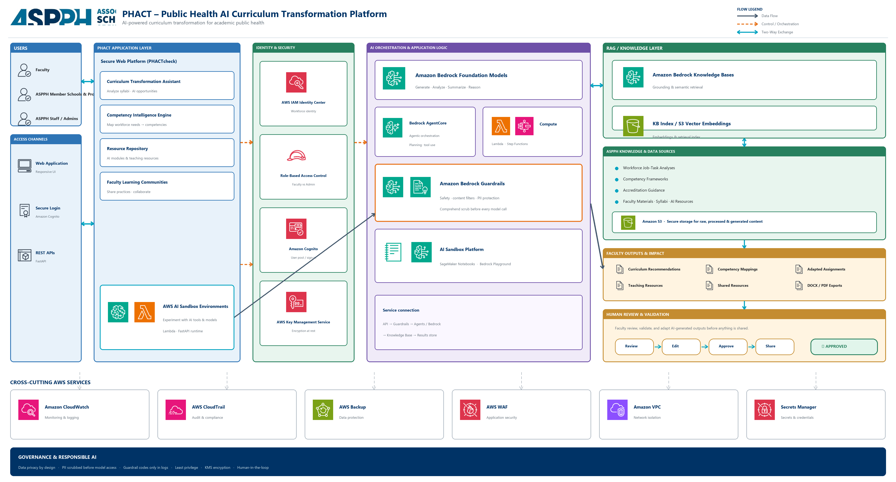

# PHACT — Public Health AI Curriculum Transformation Platform

**PHACTcheck** is an AI-assisted web platform for academic public health. Faculty upload a syllabus, describe how they want the course to evolve, and receive grounded curriculum recommendations, competency mappings, coursework ideas, and exportable reports — with human review before anything is shared.

Built for **ASPPH** (Association of Schools and Programs of Public Health) as an implementation of the PHACT solution architecture on AWS.

---

## What this project is about

Public health programs must modernize curricula for an AI-shaped workforce while staying aligned with competency frameworks and accreditation guidance. Doing that by hand is slow and uneven across schools.

PHACT helps faculty and member schools:

1. **Upload** a course syllabus (PDF / DOCX).
2. **Guide** the analysis (course focus, industry / research priorities, constraints).
3. **Generate** AI recommendations grounded in ASPPH knowledge (competencies, accreditation, teaching resources).
4. **Review** every suggestion — edit, accept, refine, or reject (human-in-the-loop).
5. **Export** DOCX / PDF reports and optionally **share** approved materials through a faculty portal.

Safety is first-class: PII is scrubbed before model access, Bedrock Guardrails filter unsafe content, and logs store **codes / IDs only** — never raw prompts, completions, or syllabus text.

---

## What the product does (faculty journey)

| Step | In the app | Behind the scenes |
|------|------------|-------------------|
| Sign in | Cognito email login | IAM / RBAC roles (Faculty vs Admin) |
| Upload | Drop syllabus on Upload page | Object stored in S3 (KMS) |
| Configure | Course focus + goals | Job record in DynamoDB |
| Generate | One-click analysis | Comprehend PII scrub → Guardrails → Bedrock Knowledge Base retrieve → agents |
| Review | Tabs: recommendations, coursework description, why it matters | Revisions tracked; refine loops supported |
| Export / share | DOCX / PDF + portal share | Pre-signed export links; audit metadata only |

Admin surfaces support universities, knowledge sources, analytics, and submission oversight.

---

## Solution architecture

Official AWS Architecture Icons. Full diagram:



### How the boxes connect

```text
Users (Faculty / Schools / Admins)
   ↕
Access (React web · Cognito login · FastAPI)
   ↕
PHACT Application Layer (PHACTcheck modules + Lambda-ready runtime)
   -→ Identity & Security (IAM Identity Center · RBAC · Cognito · KMS)
   -→ AI Orchestration (Bedrock · AgentCore · Lambda / Step Functions
                       · Guardrails + Comprehend · AI sandbox)
   ↕
RAG / Knowledge Bases ← ASPPH data sources (S3)
   ↓
Faculty outputs → Human review → APPROVED / SHARED
```

**Cross-cutting:** CloudWatch, CloudTrail, Backup, WAF, VPC, Secrets Manager.

**Governance:** privacy by design · PII scrubbed before models · guardrail codes only in logs · least privilege · KMS · human-in-the-loop.

---

## Repository layout

```text
├── frontend/          # React + Vite + Amplify Auth + shadcn/ui
├── backend/           # FastAPI API, agents, jobs, safety, observability
├── infra/             # AWS CDK (Auth, Data, Knowledge, Safety, Observability)
├── samples/           # Sample syllabus files for local trials
├── scripts/           # Helper scripts (e.g. AWS env loader)
├── PHACT-AWS-Architecture.png
└── README.md
```

Private ASPPH working materials, icon source packs, and local secrets are excluded via `.gitignore` (see below).

---

## Tech stack

| Layer | Choices |
|-------|---------|
| Frontend | React 19, Vite, TypeScript, Tailwind 4, shadcn/ui, Framer Motion, Amplify Auth |
| Backend | Python 3.12+ / 3.14, FastAPI, Mangum (Lambda-ready), boto3, pydantic-settings |
| AI | Amazon Bedrock (Claude Converse), Knowledge Bases, Guardrails, Comprehend PII |
| Data | DynamoDB, S3 (KMS), Cognito |
| Infra | AWS CDK (TypeScript) |
| Ops | Structured JSON logs, EMF metrics (`PHACT`), CloudWatch |

---

## Prerequisites

- **Node.js** 20+ and npm  
- **Python** 3.12+ (3.14 works with the project venv)  
- **AWS account** access with Bedrock, Cognito, DynamoDB, S3, Comprehend (and CDK if you deploy)  
- AWS credentials available to the **backend process only** (SSO / Workshop Studio / IAM role) — never in the browser  

---

## Get the code

```bash
git clone <YOUR_NEW_REPO_URL>
cd <repo-folder>
```

If you are creating the remote for the first time from this folder:

```bash
git init
git add .
git status   # confirm no .env / cdk-outputs / ASPPH private files
git commit -m "Initial commit: PHACT / PHACTcheck platform"
git branch -M main
git remote add origin <YOUR_NEW_REPO_URL>
git push -u origin main
```

---

## Run locally (step by step)

### 1. Deploy or obtain AWS stack outputs (required for real Cognito + data)

From a machine with CDK credentials:

```powershell
cd infra
npm install
npx cdk deploy --all --outputs-file cdk-outputs.json
npm run outputs
```

`npm run outputs` writes **public** Cognito IDs into `frontend/.env.local` (no secrets). The backend also reads `infra/cdk-outputs.json` for table/bucket/KB/guardrail IDs.

> Without deployed stacks you can still browse UI code, but login and analysis need Cognito + AWS resources.

### 2. Backend

```powershell
cd backend
py -3 -m venv .venv
.\.venv\Scripts\Activate.ps1
python -m pip install -r requirements.txt
copy .env.example .env
# Edit .env only for non-secret overrides (region, model id, CORS).
# Prefer temporary AWS credentials in the shell — do not put access keys in .env.

uvicorn app.main:app --reload --port 8000
```

Check health: [http://localhost:8000/health](http://localhost:8000/health)  
OpenAPI docs: [http://localhost:8000/docs](http://localhost:8000/docs)

`LOCAL_WORKER=true` (default) runs the analysis job worker inside the API process for local use.

### 3. Frontend

```powershell
cd frontend
npm install
# Ensure frontend/.env.local exists (from infra `npm run outputs`) with:
#   VITE_USER_POOL_ID=...
#   VITE_USER_POOL_CLIENT_ID=...
# Optional: VITE_API_BASE_URL=   (empty = use Vite proxy to :8000)

npm run dev
```

Open [http://localhost:5173](http://localhost:5173). Vite proxies `/api` and `/health` to the backend.

### 4. Try a sample syllabus

Use files under `samples/` (e.g. `EPI-501-syllabus.pdf`):

1. Sign in with a Cognito user from your pool.  
2. Upload the syllabus.  
3. Set course focus / goals → **Generate**.  
4. Review recommendations → export when ready.

---

## Environment reference

### Backend (`backend/.env`)

Copy from `backend/.env.example`. Typical overrides:

| Variable | Purpose |
|----------|---------|
| `AWS_REGION` | Default `us-east-1` |
| `BEDROCK_MODEL_ID` | Bedrock inference profile / model |
| `ALLOWED_ORIGINS` | CORS (include your Vite origin) |
| `LOCAL_WORKER` | `true` for in-process jobs locally |

Table names, buckets, KB id, and guardrail id are normally loaded from `infra/cdk-outputs.json`.

### Frontend (`frontend/.env.local`)

| Variable | Purpose |
|----------|---------|
| `VITE_USER_POOL_ID` | Cognito user pool |
| `VITE_USER_POOL_CLIENT_ID` | App client |
| `VITE_AWS_REGION` | Region (optional helper) |
| `VITE_API_BASE_URL` | Deployed API URL; leave empty for local proxy |

Never commit `.env`, `.env.local`, or AWS keys.

---

## Deploy infrastructure (optional)

```powershell
cd infra
npm install
npx cdk bootstrap   # once per account/region
npx cdk deploy --all --require-approval never --outputs-file cdk-outputs.json
npm run outputs
```

Stacks cover auth, data (DynamoDB / S3 / KMS), knowledge (Bedrock KB), safety (Guardrails), and observability (CloudWatch).

---

## Security & responsible AI (what we implement)

- **AuthN / AuthZ:** Cognito + RBAC (faculty vs admin).  
- **Encryption:** KMS for data at rest.  
- **PII:** Amazon Comprehend scrub **before** Bedrock.  
- **Guardrails:** Bedrock input safety / topic controls.  
- **Logging:** JSON + CloudWatch metrics; **no** prompts, completions, or raw assessment text.  
- **HITL:** Faculty must review before share / implement.  
- **Browser boundary:** AWS credentials never leave the backend.

---

## Regenerating the architecture diagram

```powershell
cd ASPPH\PHACT   # local only — folder is gitignored if present
# or use the builder if kept in-repo under docs/
python build_architecture_diagram_aws.py
```

The committed diagram for the README is **`PHACT-AWS-Architecture.png`** at the repo root.

---

## Troubleshooting

| Symptom | What to check |
|---------|----------------|
| Frontend throws “Cognito is not configured” | Run `npm run outputs` in `infra/` or create `frontend/.env.local` |
| `/health` fails AWS checks | Credentials in the backend shell; region; stack outputs |
| Analysis never starts | Backend running with `LOCAL_WORKER=true`; DynamoDB tables exist |
| Bedrock access denied | Model / inference profile permissions on the identity |
| CORS errors | `ALLOWED_ORIGINS` includes `http://localhost:5173` |

---

## License & attribution

PHACT / PHACTcheck implementation for ASPPH-aligned curriculum transformation.  
Architecture style follows ASPPH Appendix B; icons are [AWS Architecture Icons](https://aws.amazon.com/architecture/icons/).  
Do not commit proprietary ASPPH curricula, real student data, or production secrets.
