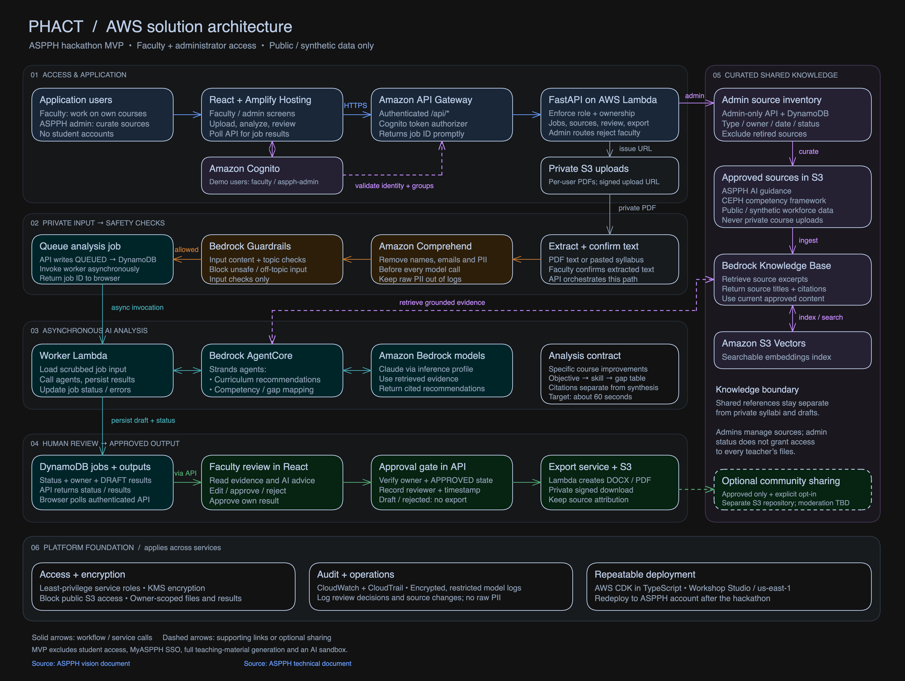

# PHACT-Syllabridge-
bridging every public health syllabus to trusted, AI-ready teaching

## Architecture

The proposed AWS architecture for the PHACT hackathon MVP covers faculty and administrator access, private syllabus processing, AI recommendations with supporting sources, and human approval before export.

Select the diagram to view it at full size.

## Development with Kiro

Use the [Kiro spec-driven development prompt](docs/kiro-spec-prompt.md) to create or update the MVP design, requirements, and implementation tasks on `sam_branch`. It includes the architecture review corrections and identifies decisions that need ASPPH confirmation.
